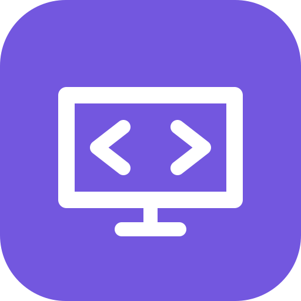
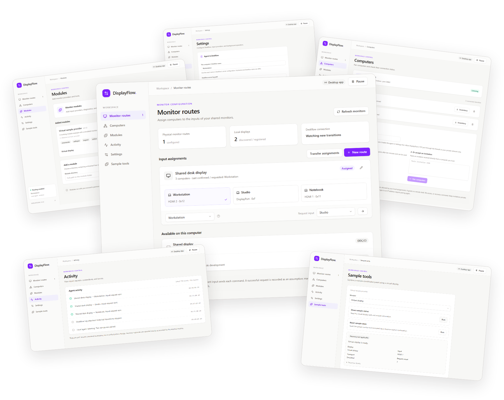

<div align="center">
  
  <h1>DisplayFlow</h1>
  <p>Monitor inputs that follow your Deskflow cursor.</p>
</div>

DisplayFlow is a desktop companion for [Deskflow](https://github.com/deskflow/deskflow) that switches monitor inputs as you move your cursor between computers.

Map each computer to its monitor input and pair your computers over the local network. Configure your displays in the app, then control switching from the Windows system tray or macOS menu bar.



<p align="center">
  <a href="https://github.com/b1ink0/DisplayFlow/releases/latest">Download for Windows</a> ·
  <a href="#build-on-macos">Build for macOS</a> ·
  <a href="docs/configuration.md">Setup guide</a>
</p>

## Features

- Multiple shared monitors, each with two or more connected computers.
- Windows DDC/CI input control and macOS BetterDisplay integration.
- Input commands sent from the computer currently using the monitor.
- Encrypted local-network connections with credentials stored by the OS.
- Automatic and manual switching, with an activity log.
- Transferable monitor assignments.
- Optional modules for additional input providers, diagnostics, and tools.
- System tray and menu bar controls, with optional startup at login.

## Supported platforms

| Platform | Input provider    | Requirements                                                                                               |
| -------- | ----------------- | ---------------------------------------------------------------------------------------------------------- |
| Windows  | Native DDC/CI     | A monitor and GPU driver that support input selection over DDC/CI; WebView2                                |
| macOS    | BetterDisplay CLI | [BetterDisplay](https://github.com/waydabber/BetterDisplay) installed, running, and accepting CLI commands |

Input control depends on the monitor, connection, and GPU driver. Automatic switching uses computer transition events from the Deskflow server log.

## Install

### Windows

Download `DisplayFlow_0.1.0_x64-setup.exe` from [Releases](https://github.com/b1ink0/DisplayFlow/releases), run the installer, and launch DisplayFlow. The installer is for Windows x64 and is not publisher-signed.

### macOS

Build the app locally using the [macOS instructions](#build-on-macos) below.

## Set up your displays

1. Run DisplayFlow on each connected computer. In **Settings**, enter its exact Deskflow computer name.
2. Enable its local agent and allow local-network access. On Windows, use the firewall setup button in Settings; macOS may show a Local Network permission prompt.
3. In **Computers**, pair agents by exchanging invitations through a trusted channel.
4. Refresh monitors. On macOS, register the display's BetterDisplay name in Settings. Add a module if your hardware needs another provider.
5. In **Monitor routes**, create a route for each shared monitor. Assign each computer, its agent, monitor ID, and input. Use **Transfer assignments** to share the configuration with paired agents.
6. On the computer running the Deskflow server, select its log file in Settings. This computer coordinates switching.
7. Select the currently visible computer under **Which picture is visible?**, resume each agent, and check manual switching in each direction. Moving your cursor between computers then uses the same assignments.
8. Enable **Start at login** if desired. Reconfirm the visible picture after restarting DisplayFlow or changing the input with the monitor's controls.

Close the window to keep DisplayFlow running in the background. Use the tray or menu bar menu to **Pause** switching or **Quit** the app.

See [configuration](docs/configuration.md) for input values, permissions, networking, and background operation.

## Modules

Modules add monitor providers, diagnostics, and custom tabs. To add one, open **Modules**, select its folder, review the executable, and confirm that you trust it.

To develop a module, start with the included virtual provider:

```sh
bun run module:sample:build
```

Add `samples/virtual-provider/dist` in Modules, then open **Sample tools**. The example simulates a monitor so you can explore the protocol without hardware.

- [Extension guide](docs/extensions.md)
- [Module protocol](docs/modules.md)
- [Virtual provider example](samples/virtual-provider/README.md)
- [TypeScript protocol types](packages/module-sdk/src/index.ts)

## Build from source

Install **Bun 1.3 or newer**, **Node.js 22 LTS**, **Rust**, and the [Tauri prerequisites](https://v2.tauri.app/start/prerequisites/). Windows needs the Visual Studio C++ workload; macOS needs Xcode command line tools.

```sh
bun install --frozen-lockfile
bun run dev
```

Run `bun run build` to create installers and application bundles in `src-tauri/target/release/bundle`.

### Build on macOS

Install the prerequisites above on your Mac, then run:

```sh
git clone https://github.com/b1ink0/DisplayFlow.git
cd DisplayFlow
bun install --frozen-lockfile
bun run build
```

Copy `src-tauri/target/release/bundle/macos/DisplayFlow.app` into `/Applications` and open it. The build targets your Mac's architecture and uses ad-hoc signing for local use; an Apple Developer account is not required. For distribution signing, see [Tauri's macOS guide](https://v2.tauri.app/distribute/sign/macos/).

| Command                       | Purpose                                         |
| ----------------------------- | ----------------------------------------------- |
| `bun run dev`                 | Desktop app with Vite development server        |
| `bun run dev:ui`              | Browser UI preview                              |
| `bun run build`               | Native application and installers               |
| `bun run check`               | Vue type checking and Rust compilation          |
| `bun run lint`                | ESLint                                          |
| `bun run format`              | Format TypeScript, Vue, documentation, and Rust |
| `bun run format:check`        | Check formatting                                |
| `bun run module:sample:build` | Build the virtual provider                      |

The browser preview supports UI configuration; hardware and network operations require the desktop application.

## Documentation

- [Configuration and troubleshooting](docs/configuration.md)
- [Architecture](docs/architecture.md)

## Contributing

For bug reports, include your OS, connection type, input provider, and relevant activity messages. Remove credentials and pairing invitations before sharing logs.

The Vue UI is in `apps/ui`, the Rust backend in `src-tauri/src`, and protocol types in `packages/module-sdk`. Before submitting changes, run `bun run check`, `bun run lint`, and `bun run format:check`.

## License

DisplayFlow and the virtual provider example are [MIT licensed](LICENSE). Dependencies and modules have their own licenses.
